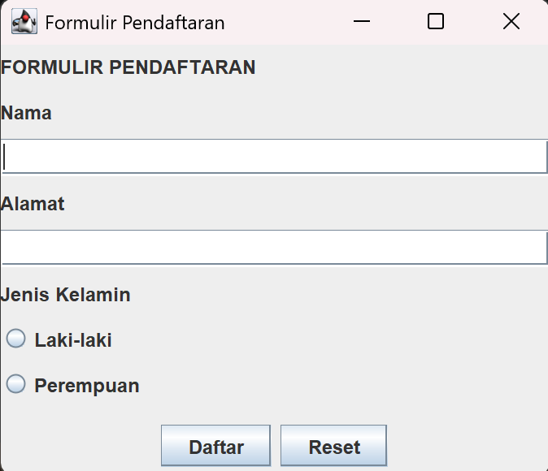

# PROGRAM FORMULIR PENDAFTARAN JAVA GUI

| Nama | NIM |
|------|-----|
| Asmaul Husnah | F1D02510106 |

## 1. Deskripsi Program
Program ini merupakan aplikasi formulir pendaftaran sederhana yang dibuat menggunakan bahasa pemrograman Java dengan menggunakan Java Swing. Program ini digunakan untuk memasukkan data berupa nama, alamat, dan jenis kelamin.

Pengguna dapat menekan tombol **Daftar** untuk menyimpan dan menampilkan data yang telah diisi. Jika data belum lengkap, program akan menampilkan pesan bahwa data belum lengkap. Tombol **Reset** digunakan untuk menghapus semua data yang sudah dimasukkan.

## 2. Komponen Utama GUI yang Digunakan
Berikut adalah 5 komponen utama GUI yang digunakan dalam program:

### 1. Top-Level Container Class
**JFrame**
JFrame digunakan sebagai jendela utama aplikasi. Pada program ini, JFrame menampilkan formulir pendaftaran yang digunakan oleh pengguna.

### 2. Intermediate Container Class
**JPanel**
JPanel digunakan sebagai tempat untuk menampung dan mengatur komponen GUI seperti label, kolom input, dan tombol agar tersusun dengan rapi.

### 3. Atomic Component Class
**JLabel, JTextField, JButton, dan JRadioButton**

- **JLabel** digunakan untuk menampilkan tulisan atau keterangan pada formulir.
- **JTextField** digunakan untuk memasukkan nama dan alamat.
- **JButton** digunakan untuk menjalankan perintah Daftar dan Reset.
- **JRadioButton** digunakan untuk memilih jenis kelamin.

### 4. Layout Classes
**BorderLayout, GridLayout, dan FlowLayout**

- **BorderLayout** digunakan untuk mengatur posisi bagian formulir dan tombol.
- **GridLayout** digunakan untuk menyusun komponen formulir secara berurutan.
- **FlowLayout** digunakan untuk mengatur posisi tombol Daftar dan Reset.

### 5. Event Listener
**ActionListener dan ActionEvent**
ActionListener digunakan untuk mendeteksi ketika tombol diklik. ActionEvent digunakan sebagai informasi dari kejadian tersebut.

Pada program ini, Event Listener digunakan pada tombol Daftar dan Reset. Method `actionPerformed()` dijalankan ketika tombol diklik untuk memanggil fungsi `daftar()` atau `reset()`.

## 3. Fitur Program
1. Mengisi nama pengguna.
2. Mengisi alamat pengguna.
3. Memilih jenis kelamin.
4. Memeriksa kelengkapan data sebelum mendaftar.
5. Menampilkan hasil pendaftaran jika data sudah lengkap.
6. Menghapus seluruh isian menggunakan tombol Reset.

## 4. Struktur Program
Program ini terdiri dari beberapa bagian:

- **Interface Aksi**: Berisi method `daftar()` dan `reset()`.
- **Abstract Class Data**: Merupakan turunan dari JFrame dan memiliki method abstract `tampilkanData()`.
- **Class Pendaftaran**: Berisi komponen GUI serta proses pendaftaran dan reset.
- **Class Main**: Digunakan untuk menjalankan program.

## 5. Cara Menjalankan Program
1. Buka project menggunakan Visual Studio Code.
2. Pastikan Java sudah terpasang.
3. Simpan kode dengan nama file `Main.java`.
4. Jalankan program melalui tombol Run atau terminal.
5. Formulir pendaftaran akan muncul dan siap digunakan.

## 6. Tampilan Program
Berikut adalah tampilan awal aplikasi formulir pendaftaran:

